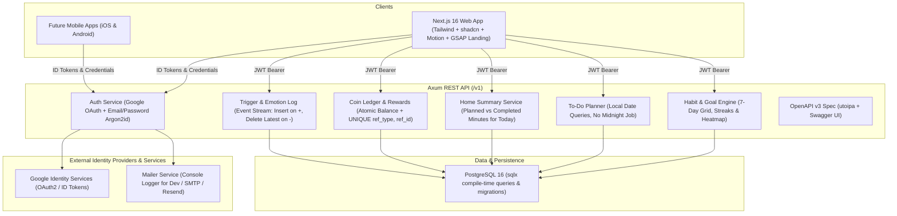

# 1degree (1degree.fit) — Architecture & Implementation Plan

> **Core Philosophy**: A plane that tilts just 1 degree ends up hundreds of miles from its original course. Small, non-negotiable daily micro-actions compound into massive personal transformations over 365 days.

---

## 1. System Architecture Overview



---

## 2. Repository & Directory Structure

```text
onedegree/
├── api/                           # Rust Axum Backend
│   ├── Cargo.toml
│   ├── migrations/                # SQLx database migrations
│   │   ├── 20261112000001_create_users_and_auth.sql
│   │   ├── 20261112000002_create_goals_and_actions.sql
│   │   ├── 20261112000003_create_todos.sql
│   │   ├── 20261112000004_create_coins_and_rewards.sql
│   │   ├── 20261112000005_create_trigger_logs.sql
│   │   ├── 20261113000001_add_auth_roles_durations_and_tokens.sql
│   │   └── 20261128000001_create_pending_registrations.sql
│   └── src/
│       ├── lib.rs                 # Library exports & router assembly
│       ├── main.rs                # Entrypoint, database connection & migrations
│       ├── config.rs              # App environment variables & ADMIN_EMAILS
│       ├── errors.rs              # Unified API error types & JSON responses
│       ├── mailer.rs              # Mailer trait & ConsoleMailer
│       ├── rate_limiter.rs        # In-memory sliding window rate limiter
│       ├── auth/                  # Authentication & authorization
│       │   ├── mod.rs
│       │   ├── google.rs          # Google JWKS ID token verification
│       │   ├── password.rs        # Argon2id password hashing & verification
│       │   ├── jwt.rs             # Access token & rotating refresh tokens
│       │   └── middleware.rs      # AuthUser & RequireAdmin extractors
│       ├── routes/                # REST endpoints (/v1/...)
│       │   ├── mod.rs
│       │   ├── auth.rs            # Google, Register, Login, Verify, Reset, Refresh
│       │   ├── home.rs            # GET /v1/home (planned vs completed minutes)
│       │   └── me.rs              # GET / PATCH /v1/me (timezone, profile, role, premium)
│       └── models.rs              # Domain structs, DTOs & DB row mappings
├── web/                           # Next.js 16 Frontend
│   ├── package.json
│   ├── tsconfig.json
│   ├── tailwind.config.ts
│   ├── src/
│   │   ├── app/
│   │   │   ├── layout.tsx         # Root layout with AuthProvider & Sonner toaster
│   │   │   └── page.tsx           # Dashboard / Google & Password auth interface
│   │   ├── components/
│   │   │   └── auth/              # GoogleSignInButton & auth widgets
│   │   └── lib/
│   │       ├── api.ts             # Typed fetch client with httpOnly refresh retry
│   │       ├── auth-context.tsx   # React auth provider & session state
│   │       └── types.ts           # Frontend TypeScript interfaces
├── docs/
│   └── architecture_and_implementation_plan.md
├── docker-compose.yml             # Local PostgreSQL 16 container
├── Makefile                       # Developer commands (db-up, dev-api, dev-web, check)
├── .env.example                   # Environment configuration template
└── README.md
```

---

## 3. Database Schema (PostgreSQL with SQLx)

### 3.1. Users & Authentication
- `users`:
  - `id`: `UUID PRIMARY KEY DEFAULT gen_random_uuid()`
  - `email`: `VARCHAR(255)` — **Nullable**. Lowercase indexed.
  - `password_hash`: `VARCHAR(255)` — **Nullable**. Argon2id hashed. Never logged or returned.
  - `full_name`: `VARCHAR(255)`
  - `avatar_url`: `TEXT`
  - `timezone`: `VARCHAR(64) NOT NULL DEFAULT 'UTC'`
  - `coin_balance`: `INTEGER NOT NULL DEFAULT 0` (negative balance allowed upon habit un-ticking)
  - `email_verified_at`: `TIMESTAMPTZ` (nullable)
  - `role`: `user_role NOT NULL DEFAULT 'user'` (`'user'`, `'subadmin'`, `'admin'`)
  - `is_premium`: `BOOLEAN NOT NULL DEFAULT false`
  - `premium_until`: `TIMESTAMPTZ` (nullable)
  - `created_at`: `TIMESTAMPTZ NOT NULL DEFAULT now()`
  - `updated_at`: `TIMESTAMPTZ NOT NULL DEFAULT now()`
  - `UNIQUE INDEX ON users (LOWER(email)) WHERE email IS NOT NULL`
- `auth_identities`:
  - `id`: `UUID PRIMARY KEY DEFAULT gen_random_uuid()`
  - `user_id`: `UUID NOT NULL REFERENCES users(id) ON DELETE CASCADE`
  - `provider`: `VARCHAR(32) NOT NULL` (e.g. `'google'`)
  - `provider_user_id`: `VARCHAR(255) NOT NULL`
  - `created_at`: `TIMESTAMPTZ NOT NULL DEFAULT now()`
  - `UNIQUE(provider, provider_user_id)`
- `refresh_tokens`:
  - `id`: `UUID PRIMARY KEY DEFAULT gen_random_uuid()`
  - `user_id`: `UUID NOT NULL REFERENCES users(id) ON DELETE CASCADE`
  - `token_hash`: `VARCHAR(255) NOT NULL UNIQUE` (SHA-256 hash)
  - `expires_at`: `TIMESTAMPTZ NOT NULL`
  - `revoked`: `BOOLEAN NOT NULL DEFAULT FALSE`
  - `created_at`: `TIMESTAMPTZ NOT NULL DEFAULT now()`
- `email_verification_tokens`:
  - `id`: `UUID PRIMARY KEY DEFAULT gen_random_uuid()`
  - `user_id`: `UUID NOT NULL REFERENCES users(id) ON DELETE CASCADE`
  - `token_hash`: `VARCHAR(255) NOT NULL UNIQUE`
  - `expires_at`: `TIMESTAMPTZ NOT NULL`
  - `used_at`: `TIMESTAMPTZ` (single-use)
  - `created_at`: `TIMESTAMPTZ NOT NULL DEFAULT now()`
- `password_reset_tokens`:
  - `id`: `UUID PRIMARY KEY DEFAULT gen_random_uuid()`
  - `user_id`: `UUID NOT NULL REFERENCES users(id) ON DELETE CASCADE`
  - `token_hash`: `VARCHAR(255) NOT NULL UNIQUE`
  - `expires_at`: `TIMESTAMPTZ NOT NULL`
  - `used_at`: `TIMESTAMPTZ` (single-use)
  - `created_at`: `TIMESTAMPTZ NOT NULL DEFAULT now()`

### 3.2. Goals & Daily Actions
- `goals`:
  - `id`: `UUID PRIMARY KEY DEFAULT gen_random_uuid()`
  - `user_id`: `UUID NOT NULL REFERENCES users(id) ON DELETE CASCADE`
  - `title`: `VARCHAR(255) NOT NULL`
  - `description`: `TEXT`
  - `start_date`: `DATE NOT NULL DEFAULT CURRENT_DATE`
  - `target_milestone_days`: `INTEGER NOT NULL DEFAULT 90`
  - `color_hex`: `VARCHAR(16) NOT NULL DEFAULT '#10b981'`
  - `is_archived`: `BOOLEAN NOT NULL DEFAULT FALSE`
  - `archived_at`: `TIMESTAMPTZ`
  - `created_at`: `TIMESTAMPTZ NOT NULL DEFAULT now()`
- `daily_actions`:
  - `id`: `UUID PRIMARY KEY DEFAULT gen_random_uuid()`
  - `goal_id`: `UUID NOT NULL REFERENCES goals(id) ON DELETE CASCADE`
  - `user_id`: `UUID NOT NULL REFERENCES users(id) ON DELETE CASCADE`
  - `title`: `VARCHAR(255) NOT NULL`
  - `duration_minutes`: `SMALLINT CHECK (duration_minutes IS NULL OR (duration_minutes >= 1 AND duration_minutes <= 600))`
  - `coin_reward`: `INTEGER NOT NULL DEFAULT 10`
  - `is_archived`: `BOOLEAN NOT NULL DEFAULT FALSE`
  - `archived_at`: `TIMESTAMPTZ`
  - `created_at`: `TIMESTAMPTZ NOT NULL DEFAULT now()`
- `action_logs`:
  - `id`: `UUID PRIMARY KEY DEFAULT gen_random_uuid()`
  - `action_id`: `UUID NOT NULL REFERENCES daily_actions(id) ON DELETE CASCADE`
  - `user_id`: `UUID NOT NULL REFERENCES users(id) ON DELETE CASCADE`
  - `log_date`: `DATE NOT NULL`
  - `status`: `VARCHAR(16) NOT NULL DEFAULT 'done' CHECK (status IN ('done', 'missed'))`
  - `completed_at`: `TIMESTAMPTZ NOT NULL DEFAULT now()`
  - `coins_earned`: `INTEGER NOT NULL DEFAULT 0` (0 if missed or backdated; >0 only for current day done ticks)
  - `notes`: `TEXT`
  - `UNIQUE(action_id, log_date)`

### 3.3. To-Do Planner
- `todos`:
  - `id`: `UUID PRIMARY KEY DEFAULT gen_random_uuid()`
  - `user_id`: `UUID NOT NULL REFERENCES users(id) ON DELETE CASCADE`
  - `title`: `VARCHAR(255) NOT NULL`
  - `target_date`: `DATE NOT NULL`
  - `duration_minutes`: `SMALLINT CHECK (duration_minutes IS NULL OR (duration_minutes >= 1 AND duration_minutes <= 600))`
  - `is_completed`: `BOOLEAN NOT NULL DEFAULT FALSE`
  - `completed_at`: `TIMESTAMPTZ`
  - `coin_reward`: `INTEGER NOT NULL DEFAULT 5`
  - `coins_earned`: `INTEGER NOT NULL DEFAULT 0` (0 if beyond first 3 to-dos limit of the day)
  - `created_at`: `TIMESTAMPTZ NOT NULL DEFAULT now()`

### 3.4. Coins Economy & Rewards
- `coin_transactions`:
  - `id`: `UUID PRIMARY KEY DEFAULT gen_random_uuid()`
  - `user_id`: `UUID NOT NULL REFERENCES users(id) ON DELETE CASCADE`
  - `amount`: `INTEGER NOT NULL`
  - `ref_type`: `VARCHAR(32) NOT NULL` (`'habit_tick'`, `'habit_reversal'`, `'todo_completed'`, `'reward_redeemed'`)
  - `ref_id`: `UUID NOT NULL`
  - `description`: `VARCHAR(255) NOT NULL`
  - `created_at`: `TIMESTAMPTZ NOT NULL DEFAULT now()`
  - `UNIQUE (ref_type, ref_id)`
- `rewards`:
  - `id`: `UUID PRIMARY KEY DEFAULT gen_random_uuid()`
  - `user_id`: `UUID NOT NULL REFERENCES users(id) ON DELETE CASCADE`
  - `title`: `VARCHAR(255) NOT NULL`
  - `coin_cost`: `INTEGER NOT NULL CHECK (coin_cost > 0)`
  - `is_archived`: `BOOLEAN NOT NULL DEFAULT FALSE`
  - `created_at`: `TIMESTAMPTZ NOT NULL DEFAULT now()`
- `reward_redemptions`:
  - `id`: `UUID PRIMARY KEY DEFAULT gen_random_uuid()`
  - `reward_id`: `UUID NOT NULL REFERENCES rewards(id) ON DELETE CASCADE`
  - `coins_spent`: `INTEGER NOT NULL`
  - `redeemed_at`: `TIMESTAMPTZ NOT NULL DEFAULT now()`

---

## 4. Core Business Rules

1. **Authentication (Google & Email/Password)**:
   - Passwords hashed with **Argon2id** (minimum 8 characters).
   - Email is lowercased across all registration and login queries.
   - If an email already belongs to an account, `POST /v1/auth/register` returns the generic `201` response without storing an unverified `users` row and dispatches a rate-limited existing-account notice email; unverified sign-ups live only in `pending_registrations` until verified.
   - Same error message for wrong email and wrong password (`"Invalid email or password"`, HTTP `401`), with dummy Argon2 timing parity when an account does not exist.
   - **Verified Email Requirement**: `POST /v1/auth/login` requires verified email. A valid email/password for an active unverified sign-up in `pending_registrations` returns HTTP `403` with error code `EMAIL_NOT_VERIFIED`, issues no tokens, and sets no cookie. Google sign-ins count as verified when Google's `email_verified` claim is `true` (and clear any matching `pending_registrations` row).
   - Password hashes are **never logged or returned** in any API response.
   - Login, registration, and verification-resend requests are **rate limited** via in-memory sliding window limiter.
2. **Email Verification, Resend & Password Reset**:
   - Unverified sign-ups store their password hash and SHA-256 token hash (`token_hash`) in `pending_registrations` with explicit expiration (24h verification, 60s resend cooldown, 24h `send_count` cap of 5, and `failed_attempts` lockout after 5 wrong passwords).
   - `POST /v1/auth/verify-email` requires `{ token, password }` and atomically verifies the sign-up password, creates the verified `users` row, and deletes the pending registration so passive link scanners or wrong-password callers never activate an account.
   - `POST /v1/auth/resend-verification` always returns a generic `200 OK` whether or not a pending sign-up exists, enforces per-IP and per-email rate limits plus a 60-second per-email cooldown and 24h cap of 5, and rotates `token_hash` cleanly.
   - `MAILER` selects `console` (default for `development`/`local`/`test`, used by `make dev`), `file` (`local`/`test` only, writing JSONL to `/tmp/onedegree-mail-outbox.jsonl` with mode `0600`), or `resend` (`resend-rs`, also enabled in local dev via `make dev-mail`). Missing or unknown `APP_ENV` fails closed as `production`, refusing `console`/`file` and requiring `resend` + HTTPS `WEB_BASE_URL`.
3. **Role & Admin Privileges**:
   - `ADMIN_EMAILS` read from environment (e.g. `sohelhussaing@gmail.com`).
   - A user is granted `role = 'admin'` **only upon verified email** (Google `email_verified == true` or confirmed password email verification token).
   - Unverified accounts cannot become admin.
   - No API endpoint may alter a user's role. Protected routes use the `RequireAdmin` extractor.
4. **Dynamic Premium Calculation (`has_premium`)**:
   - $\text{has\_premium}(u) = (u.\text{role} == \text{admin}) \lor (u.\text{is\_premium} \land (u.\text{premium\_until} \text{ is null} \lor u.\text{premium\_until} > \text{now}()))$.
   - Computed on demand in a single function; never redundantly stored.
5. **Planned & Completed Minutes (`GET /v1/home`)**:
   - $\text{Planned Minutes} = \sum_{\text{active actions}} \text{duration} + \sum_{\text{todos for today}} \text{duration}$.
   - $\text{Completed Minutes} = \sum_{\text{done action logs today}} \text{duration} + \sum_{\text{completed todos today}} \text{duration}$.
   - Durations are constrained between 1 and 600 minutes.
6. **Habit Ticks & Coin Ledger**:
   - Editable for the last 7 days only.
   - Backdated ticks earn 0 coins. Only ticks for today award coins.
   - Un-ticking a habit writes a `'habit_reversal'` entry with negative coins to `coin_transactions`.
   - First 3 completed to-dos per calendar day earn coins; subsequent earn 0.

---

## 5. REST API Endpoint Specification (`/v1`)

| Method | Endpoint | Description | Auth Required |
|---|---|---|---|
| `POST` | `/v1/auth/google` | Verify Google ID token, link identity, issue tokens | No |
| `POST` | `/v1/auth/register` | Register with email & password (Argon2id, min 8 chars, rate-limited) | No |
| `POST` | `/v1/auth/login` | Login with email & password (rate-limited, requires verified email or 403 `EMAIL_NOT_VERIFIED`) | No |
| `POST` | `/v1/auth/verify-email` | Verify `{ token, password }` to create verified user & clear pending row | No |
| `POST` | `/v1/auth/resend-verification` | Resend verification link (generic 200, 60s cooldown, invalidates old tokens) | No |
| `POST` | `/v1/auth/forgot-password` | Dispatch password reset token email via Mailer | No |
| `POST` | `/v1/auth/reset-password` | Reset password using single-use token & revoke sessions | No |
| `POST` | `/v1/auth/refresh` | Rotate refresh token (httpOnly cookie, replay defense) | No |
| `POST` | `/v1/auth/logout` | Revoke refresh token and clear cookie | No |
| `GET` | `/v1/me` | Fetch authenticated user profile, role & has_premium | Yes |
| `PATCH` | `/v1/me` | Update user timezone, full_name, avatar_url | Yes |
| `GET` | `/v1/home` | Get today's planned and completed minutes summary | Yes |
| `GET` | `/v1/swagger-ui` | Interactive OpenAPI documentation | No |
