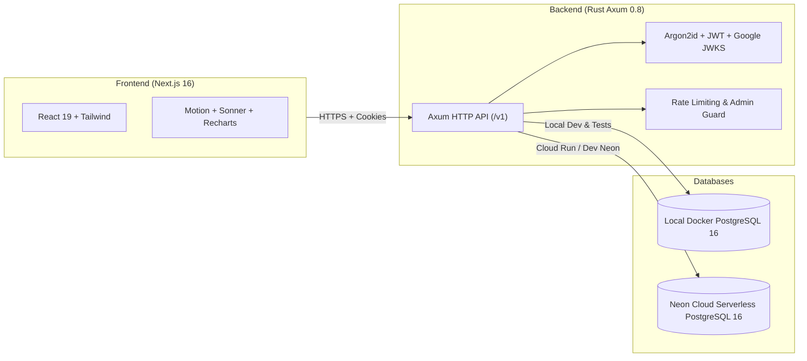
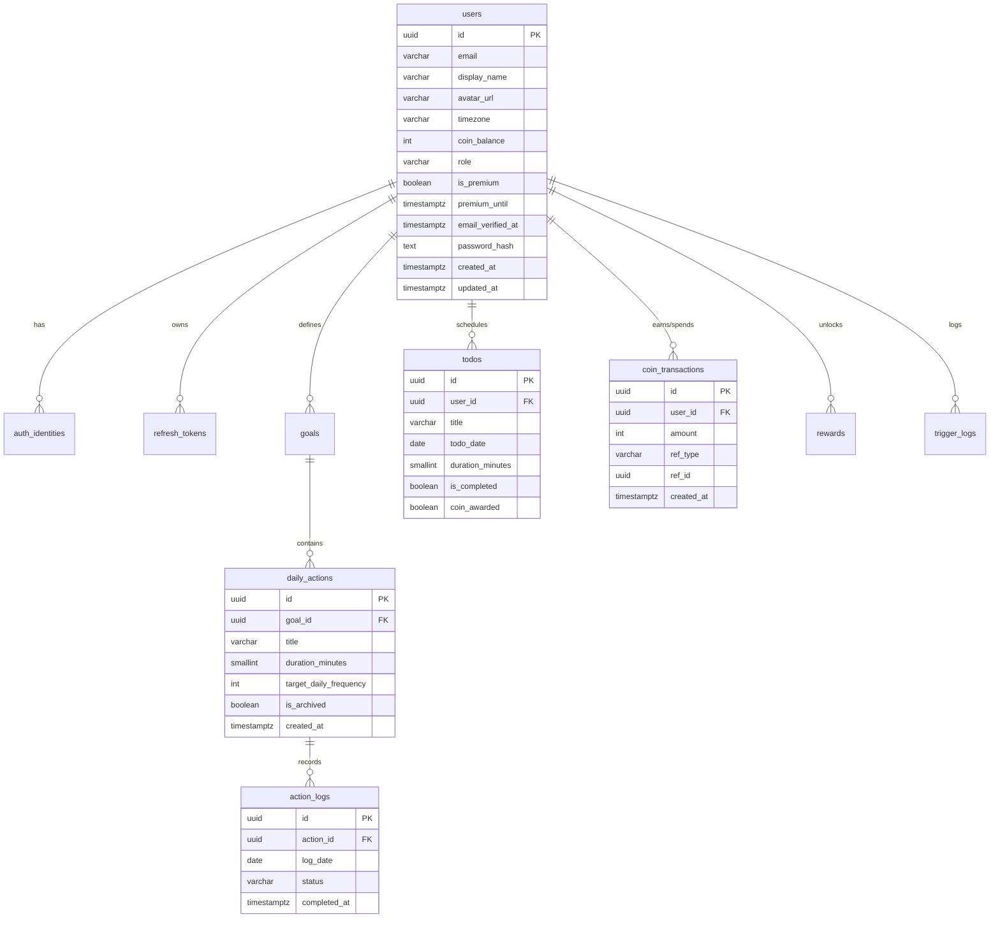

# 1degree (`1degree.fit`) — Implementation & Progress Report

**Date**: November 24, 2026  
**Status**: Phase 1, Phase 2, Phase 2.5, Neon Setup & Security Cleanup Complete  
**Repository**: [onedegree (GitHub)](https://github.com/sohelhussain/onedegree.git)

---

## 1. Executive Summary

`1degree` is a habit and personal growth platform built around the **1-degree rule**: small, 1% daily shifts compound into transformational results over 365 days. 

This report provides a detailed record of all work accomplished to date across the foundational infrastructure, database schema, authentication system, role/permission modeling, cloud database provisioning, and security hardening.

---

## 2. Technology Stack & Environment

| Component | Technology | Role & Highlights |
| :--- | :--- | :--- |
| **Backend API** | Rust 1.86 + Axum 0.8 | High-performance asynchronous REST API, Tokio runtime |
| **Database Access** | SQLx 0.8 | Compile-time checked queries, connection pooling, migrations |
| **Local Database** | Docker PostgreSQL 16 | Containerized local instance on port `5432` |
| **Cloud Database** | Neon Serverless Postgres 16 | AWS Singapore (`aws-ap-southeast-1`), scale-to-zero, branchable |
| **Frontend Web** | Next.js 16 (App Router) + React 19 | Tailwind CSS, Motion (animation), Sonner (toast notifications), Recharts |
| **Authentication** | Dual Token (JWT + Refresh Cookie) | Argon2id hashing, Google OAuth JWKS verification, rotation & replay defense |
| **Documentation** | Utoipa + Swagger UI | Auto-generated OpenAPI v3 documentation at `/v1/swagger-ui` |

---

## 3. Work Completed by Phase

### Phase 1: Project Scaffolding & Database Foundations
- **Monorepo Layout**: Configured clean dual-service architecture (`api/` and `web/`).
- **Local Dev Workflow**: Configured `docker-compose.yml` and `Makefile` for one-command startup (`make db-up`, `make dev-api`, `make dev-web`).
- **Initial SQLx Migrations**:
  - `20261112000001_create_users_and_auth.sql`: Core users, identities, refresh tokens.
  - `20261112000002_create_goals_and_actions.sql`: Goals, daily actions, action logs with `status` (`done` | `missed`).
  - `20261112000003_create_todos.sql`: Daily to-dos with local date queries and 3-coin/day earning cap.
  - `20261112000004_create_coins_and_rewards.sql`: `coin_transactions` with `UNIQUE (ref_type, ref_id)` enforcing double-credit protection and habit tick/reversal accounting.
  - `20261112000005_create_trigger_logs.sql`: Event stream without polarity column (+ inserts, - deletes latest row for that local date).

### Phase 2: Google OAuth & Session Management
- **Google Token Verification** (`api/src/auth/google.rs`):
  - Validates Google ID tokens against Google’s public JWKS endpoint.
  - Enforces `iss`, `aud`, and `exp` validation.
- **Rotating Refresh Token System** (`api/src/auth/jwt.rs`):
  - 15-minute stateless JWT access tokens.
  - 30-day rotating refresh tokens stored securely as SHA-256 hashes.
  - **Replay Attack Defense**: Reusing an old/rotated refresh token triggers immediate revocation of **all** sessions for that user account.
  - Tokens delivered via `httpOnly`, `SameSite=Lax`, secure cookies.
- **Endpoints**:
  - `POST /v1/auth/google`: Sign-in / registration via Google.
  - `POST /v1/auth/refresh`: Refresh token rotation.
  - `POST /v1/auth/logout`: Revokes active refresh token and clears cookie.
  - `GET /v1/me` & `PATCH /v1/me`: Profile inspection and timezone preference updates.

### Phase 2.5: Email/Password Auth, Roles, Durations & Summary
- **Migration** (`20261113000001_add_auth_roles_durations_and_tokens.sql`):
  - User enhancements: `password_hash`, `email_verified_at`, `role` (`user`, `subadmin`, `admin`), `is_premium`, `premium_until`.
  - Unique case-insensitive index on `lower(email) WHERE email IS NOT NULL`.
  - Smallint durations on `daily_actions.duration_minutes` and `todos.duration_minutes` with `CHECK (duration_minutes BETWEEN 1 AND 600)`.
  - Token tables: `email_verification_tokens` and `password_reset_tokens`.
- **Argon2id Authentication** (`api/src/auth/password.rs`):
  - Secure registration and login with minimum 8 characters.
  - Protection against Google collision: directs users to sign in with Google if an email is already associated with Google OAuth.
  - Password hashes are never logged, never returned in API responses, and protected against user enumeration via uniform error messages.
- **Role & Entitlement Architecture**:
  - `ADMIN_EMAILS` bootstrap logic: users are promoted to `admin` **only** upon verified email confirmation.
  - `RequireAdmin` Axum extractor to gate administrative endpoints.
  - Single-source computed `has_premium(user)`: true if the user is an admin or holds an active premium subscription.
- **Mailer Abstraction**:
  - `Mailer` trait with local development `ConsoleMailer`.
  - **Production Fail-Safe**: Axum server refuses to start if `APP_ENV=production` and `ConsoleMailer` is configured.
- **Home Summary Endpoint** (`api/src/routes/home.rs`):
  - `GET /v1/home`: Computes planned vs. completed minutes for today based on the user's localized timezone.
- **Rate Limiting**:
  - Sliding-window in-memory limiter protecting `/v1/auth/register` and `/v1/auth/login`.

### Cloud Database & Security Hardening
- **Neon Cloud Postgres**:
  - Project `1degree` (`jolly-sea-36838969`) in `aws-ap-southeast-1` (Singapore) on Postgres 16.
  - Direct connection string isolated as `DATABASE_URL_NEON` in `api/.env`.
  - Added `make dev-api-neon` to run against Neon without credential leaks.
  - SQLx pool configured with `min_connections(0)` and `acquire_timeout(10s)` for serverless compatibility.
  - Integration tests explicitly isolated to the local Docker database.
- **Security & Secret Cleanup**:
  - Cleaned up unneeded authentication keys.
  - Regenerated random 32-byte `JWT_SECRET`.
  - Cleaned `web/.env.local` to contain only `NEXT_PUBLIC_*` variables.
  - Configured git remote `origin` to `https://github.com/sohelhussain/onedegree.git`.

---

## 4. Complete Database Schema Ledger

---

## 5. API Endpoints Catalog

| Method | Path | Description | Auth Required |
| :--- | :--- | :--- | :--- |
| `POST` | `/v1/auth/google` | Authenticate or register with Google ID token | No |
| `POST` | `/v1/auth/register` | Register with email and password | Rate Limited |
| `POST` | `/v1/auth/login` | Login with email and password | Rate Limited |
| `POST` | `/v1/auth/refresh` | Rotate refresh token cookie, get new JWT | Refresh Cookie |
| `POST` | `/v1/auth/logout` | Revoke active refresh token and clear cookie | Refresh Cookie |
| `GET` | `/v1/me` | Fetch authenticated user profile & entitlements | Bearer JWT |
| `PATCH` | `/v1/me` | Update profile attributes (timezone) | Bearer JWT |
| `GET` | `/v1/home` | Daily summary: planned & completed minutes | Bearer JWT |
| `GET` | `/v1/swagger-ui` | Interactive OpenAPI documentation UI | No |

---

## 6. Verification & Automated Test Status

All 10 backend integration and unit tests pass against the local database:
- `test_jwt_generation_and_verification` (Token generation, claims, expiry)
- `test_refresh_token_hashing` (SHA-256 rotation hashing)
- `test_argon2_hashing_and_verification` (Argon2id hashing & verification)
- `test_token_rotation` (Refresh token rotation mechanics)
- `test_replayed_refresh_token_revokes_all_sessions` (Replay attack detection & revocation)
- `test_duplicate_email_rejected` (Case-insensitive unique email constraint)
- `test_hash_never_returned` (Security check ensuring password hash is never serialized)
- `test_unverified_email_cannot_become_admin` (Admin role gating)
- `test_admin_has_premium` (Computed premium status)
- `test_duration_check` (Duration check constraint `1..600`)

Frontend validation:
- Next.js 16 build passes cleanly with zero TypeScript or packaging errors (`pnpm build`).

---

## 7. Next Phase: Phase 3 (Core Habit Engine)

The following capabilities are specified in `docs/architecture_and_implementation_plan.md` and ready to be built in Phase 3:
1. **Habit Ticking Engine**:
   - `POST /v1/actions/{id}/tick` (status: `done` or `missed`).
   - 7-day edit window enforcement.
   - Coin reward calculation (1 coin for today's tick; 0 coins for backdated ticks or missed actions).
   - Atomic coin transaction logging with `UNIQUE (ref_type, ref_id)`.
2. **Habit Un-ticking & Reversals**:
   - `DELETE /v1/actions/{id}/tick/{log_date}`.
   - Deletion of action log row and recording of `habit_reversal` transaction.
   - Balance adjustment permitting negative coin balance if already spent.
3. **Goal Progress % Calculation**:
   - Expected ticks: sum of active days per action since `daily_actions.created_at`.
   - Completed ticks: total `done` logs.
4. **Action & Goal Management**:
   - CRUD for goals and daily actions with soft-archiving (`is_archived = true`).
